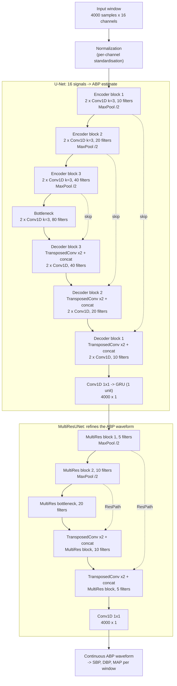
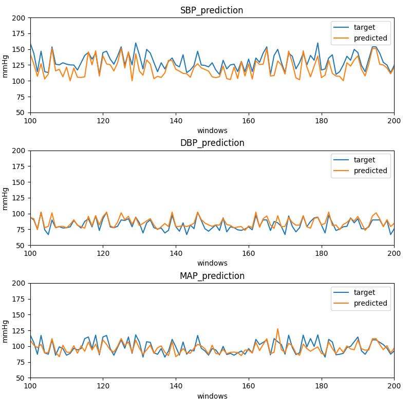
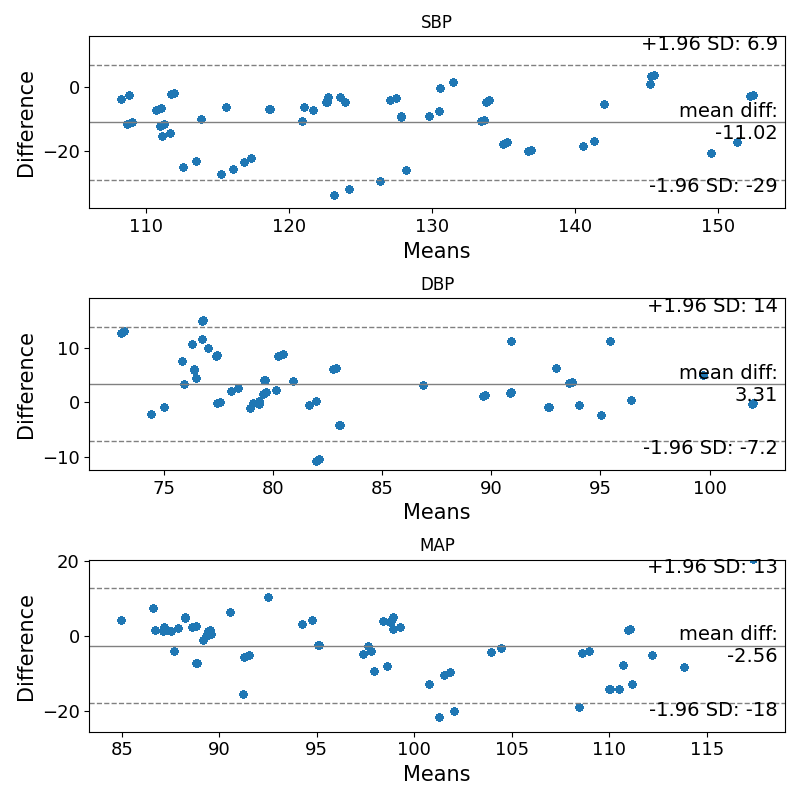

# Arterial Blood Pressure Prediction

Thesis project: a convolutional **U-Net** that takes several continuous
physiological signals recorded by a multi-sensor device (ECG, PPG,
accelerometers, bioimpedance, acoustic, respiration, temperature) and
reconstructs the **continuous arterial blood pressure (ABP) waveform**, beat by
beat, without a cuff.

From the predicted waveform the usual clinical values are derived for every
window: systolic (SBP), diastolic (DBP) and mean arterial pressure (MAP).

- **Task**: sequence-to-sequence regression, one ABP value per input sample
- **Model**: two U-Nets in series, a 1D U-Net followed by a MultiResUNet
  (Python, TensorFlow / Keras)
- **Reference**: brachial ABP measured continuously by a Finometer device
- **Evaluation**: MAE and standard deviation on SBP, DBP and MAP; Bland-Altman analysis

## How it works

### 1. Data

Each recording session is cut into **10-second windows** sampled at 400 Hz
(4000 samples) with **16 input channels**, grouped by frequency content:

| Group | Channels |
| --- | --- |
| high frequency | acoustic |
| medium frequency | accelerometer (x, y, z, magnitude), bioimpedance, ECG, PPG (green, infrared, red), SCG |
| low frequency | respiration (3 sensors), body temperature, external temperature |

The target is the brachial ABP of the same window, on the same time axis. A
mask marks the parts of the ABP signal that are not valid (artefacts,
recalibrations of the reference device): those samples get zero weight in the
loss, so the network never learns from a corrupted reference.

Sessions are split into training, validation and test sets by recording date
(`data/in_house_data_partitioning.yaml`), so the test set always comes from a
different day than the training data.

The code also supports the public UCI
[Cuff-Less Blood Pressure Estimation](https://archive.ics.uci.edu/dataset/340/cuff+less+blood+pressure+estimation)
dataset (PPG and ECG at 125 Hz), which is downloaded and preprocessed by the scripts in `data/`.

### 2. Model

The best configuration chains two encoder-decoder networks: the first U-Net
maps the 16 signals to a first ABP estimate, and the second (a MultiResUNet)
refines that single-channel waveform.



- **U-Net**: the encoder halves the time resolution at every block while
  doubling the filters, so deeper layers see longer stretches of signal (the
  whole heartbeat); the decoder restores the original resolution, and the skip
  connections bring back the fine timing detail lost by pooling. A final GRU
  smooths the output along time.
- **MultiResUNet**: every block runs three convolutions in sequence and
  concatenates their outputs (1/6, 1/3 and 1/2 of the filters), which captures
  patterns at several time scales at once, plus a 1x1 residual connection.
  Skip connections go through a *ResPath* (a chain of residual convolutions)
  that narrows the gap between encoder and decoder features.
- Every convolution uses kernel size 3, Leaky ReLU and L2 regularisation (0.01).
- Other variants are available through `modeling/hyperparameters.yaml`: batch
  normalisation, GRU layers after encoder, bottleneck or along skip connections,
  a multi-branch encoder (one branch per frequency group), a single U-Net, and
  frequency-domain or time-frequency (spectrogram) inputs.

### 3. Training

- Loss: mean squared error on the waveform, weighted by the validity mask
- Optimizer: Adam (learning rate 0.001), mini-batches of 64 windows, 3000 epochs
- Metrics: mean absolute error and mean signed error (bias)
- The model with the lowest validation error is saved (`ModelCheckpoint`); losses and metrics are logged to TensorBoard
- Seeds are fixed for reproducible runs

## Results

Subject-specific model (`subject_specific_model/`): trained, validated and
tested on different recording days of the same subject. Errors in mmHg on the
test set, mean absolute error ± standard deviation:

| Experiment | SBP | DBP | MAP |
| --- | --- | --- | --- |
| U-Net (32 filters, 3 blocks) + MultiResUNet (32 filters, 3 blocks) | 11.3 ± 6.2 | 6.3 ± 5.2 | 5.7 ± 4.1 |
| U-Net (10 filters, 3 blocks) + GRU + MultiResUNet (5 filters, 2 blocks) | **10.4 ± 6.1** | 5.6 ± 4.7 | 6.9 ± 6.5 |
| same configuration, `_2layer` run | 11.8 ± 8.2 | **3.9 ± 3.7** | **4.9 ± 3.8** |

The smaller network generalises better than the larger one: with data from a
single subject, fewer parameters mean less overfitting.

Predicted vs reference values, one point per 10-second window:



Bland-Altman analysis (difference vs mean of prediction and reference):



**Limits.** DBP and MAP follow the reference closely, while SBP is
systematically underestimated (mean difference about -11 mmHg): the network
smooths the systolic peaks. The results come from one subject, so they show
that the approach works, not that it generalises to new people; the
`general_model/` folder contains the multi-subject setup.

## Project structure

```
general_model/            multi-subject setup
subject_specific_model/   one model per subject (results above)
  data/                   download and preprocessing of the datasets, data split
  modeling/
    model_architectures.py      U-Net, MultiResUNet and other architectures
    samples_and_labels.py       input pipeline (tf.data): windows, labels, mask
    training_and_validation.py  training loop, checkpoints, TensorBoard
    load_model_and_predict.py   interactive prediction plots on a trained model
    hyperparameters.yaml        architecture and training settings
    metrics.py                  custom metrics (mean signed error)
  results/<experiment>/   trained model, hyperparameters, metrics and plots
```

## How to run it

Requirements: **Python 3.10** (TensorFlow 2.10 supports Python 3.7-3.10).
Every command runs from inside the model folder, because paths are relative to
the current directory.

```bash
cd subject_specific_model          # or general_model
python3.10 -m venv .venv
source .venv/bin/activate
pip install -r requirements.txt
```

Preprocess the raw recordings into training, validation and test windows (the
in-house dataset is not public; use the UCI scripts in `data/` for public data):

```bash
python data/preprocess_original_in_house_dataset.py --mode automatic --partitioning in_house_data_partitioning.yaml
```

Draw the model architecture (`modeling/model.png`; needs `pip install pydot`
and Graphviz):

```bash
python modeling/model_architectures.py --domain time --task waveform --data in-house
```

Train and validate (the results go to `results/<experiment-name>/`):

```bash
python modeling/training_and_validation.py --domain time --task waveform --data in-house --name <experiment-name>
```

Follow training in TensorBoard:

```bash
python -m tensorboard.main --logdir results/<experiment-name>/training_and_validation_statistics
```

Plot the predictions of a trained model, for example of the experiment in the
results above:

```bash
python modeling/load_model_and_predict.py --domain time --task waveform --data in-house --name "3U-Net+decoder+MSE+10_3+5_2+3000_2layer"
```

## Tech stack

Python, TensorFlow / Keras, NumPy, SciPy, Matplotlib, TensorBoard.
